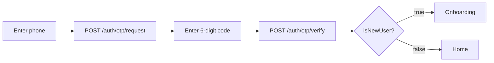
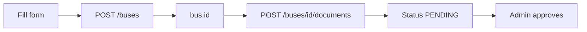

# GO-GO Ride API — Frontend Integration Guide

_Last updated 2026-09-20 · living version: <https://claude.ai/code/artifact/94ab2113-4c88-48b8-b051-74a1e205b331>_

## Start here

One REST API serves all three surfaces — passenger app, public website, admin panel. 93 endpoints, every screen in the deck covered.

The API exists in two implementations that return the same JSON. Build against either; switching is a base-URL change.

| Implementation | Base URL | Interactive docs |
| --- | --- | --- |
| Node / Express | `http://localhost:4000/api` | `http://localhost:4000/docs` |
| Python / FastAPI | `http://localhost:8000/api` | `http://localhost:8000/docs` |

Their OpenAPI specs were diffed: same 93 paths and methods, and no field present in one is missing from the other.

### Run it locally

```bash
cd backend && npm install && cp .env.example .env && npm run db:reset && npm run dev
```

```bash
cd backend-python && python -m venv .venv && .venv/Scripts/pip install -r requirements.txt && .venv/Scripts/python seed.py && .venv/Scripts/uvicorn app.main:app --reload --port 8000
```

Both seed the same demo data: 18 Kolkata stops, 7 routes, 7 buses, 4 local cars, 40 bookings.

### Seeded logins

| Role | Phone | Password | Screens it unlocks |
| --- | --- | --- | --- |
| Passenger | `9123456789` | `Rider@123` | app, alarms, bookings, favourites |
| Bus owner | `9876543210` | `Owner@123` | Add Bus, my buses |
| Driver | `9000011223` | `Driver@123` | local car listings |
| Admin | `9876500002` | `Admin@123` | admin panel |
| Super admin | `9876500001` | `Admin@123` | admin panel + user management |

### Try it before writing code

Open `/docs`, run `POST /auth/login`, copy `data.accessToken`, press **Authorize**, paste it. Every endpoint is then callable from the browser against real data — faster than guessing from this page.

CORS already allows `localhost:3000` and `localhost:5173`. For another port, add it to `CORS_ORIGINS` in the backend `.env`.

## Response shape and errors

Every response has the same envelope, so one unwrap helper covers the whole API.

**Success:**

```json
{ "success": true, "message": "Logged in successfully", "data": { } }
```

**List endpoints add `meta`:**

```json
{ "success": true, "message": "Success", "data": [ ], "meta": { "page": 1, "limit": 20, "total": 42, "totalPages": 3 } }
```

**Failure** — same envelope, `success: false`, plus a stable `code` you can switch on:

```json
{
  "success": false,
  "message": "Validation failed",
  "code": "BAD_REQUEST",
  "details": [{ "field": "phone", "message": "Enter a valid 10-digit mobile number" }]
}
```

`message` is written to be shown to users as-is. `details` appears only on validation failures, one entry per bad field — map `field` to your form input to highlight it.

### Error codes

| HTTP | `code` | What it means for the UI |
| --- | --- | --- |
| 400 | `BAD_REQUEST` | Validation or a rule failed. Show `message`; use `details` for field errors. |
| 401 | `UNAUTHORIZED` | No token, expired token, or wrong password. Refresh once, then send to login. |
| 403 | `FORBIDDEN` | Wrong role, or account blocked. Do not retry — hide the control instead. |
| 404 | `NOT_FOUND` | Record gone or never existed. |
| 409 | `CONFLICT` / `DUPLICATE` | Already exists (phone, bus number, duplicate alarm). |
| 429 | `TOO_MANY_REQUESTS` | Rate limited. Auth endpoints allow 20 attempts per 15 min; everything else 300/min. |
| 400 | `INVALID_REFERENCE` | You sent an id that does not exist. |

`data` is `null` on failures, and on successes that carry no payload (deletes, logout).

## Authentication

Send `Authorization: Bearer <accessToken>` on every authenticated call. Access tokens last **15 minutes**; refresh tokens last 30 days and rotate on use.

### Two ways in

**Password** — `POST /auth/login` with `{ phone, password }`.

**OTP** — the flow the app's Login / Register screen uses:



In development `POST /auth/otp/request` returns the code as `data.devCode` and logs it to the server console, so you can test without an SMS gateway. It disappears in production — never build UI that depends on it.

`POST /auth/otp/verify` **creates the account** if the phone is new and returns `data.isNewUser: true`. There is no separate sign-up call for OTP users.

Both return the same payload:

```json
{ "data": { "user": { "id": "...", "name": "Ritaban Guchait", "role": "PASSENGER" },
            "accessToken": "eyJ...", "refreshToken": "eyJ..." } }
```

### Refresh and logout

`POST /auth/refresh` with `{ refreshToken }` returns a **new pair** and revokes the one you sent. Store the new refresh token or the next refresh fails. Run one refresh at a time — two parallel refreshes with the same token means the second gets 401.

`POST /auth/logout` with `{ refreshToken }` kills that session; omit the body to sign out every device.

A password change revokes all other sessions, so expect a 401 on other devices afterwards.

### Role gating

`user.role` decides what to render. Gate the UI on it, but never trust it for security — the API re-checks.

| Role | Can reach |
| --- | --- |
| `PASSENGER` | search, alarms, bookings, favourites, profile, support |
| `BUS_OWNER` | all of the above + `POST /buses`, `/buses/mine/list`, documents, non-operating dates |
| `DRIVER` | all passenger routes + local car listings, publishing rides |
| `ADMIN` | everything under `/admin` except creating and deleting users |
| `SUPER_ADMIN` | everything, including `POST` / `DELETE /admin/users` and granting admin roles |

A blocked or inactive account gets 403 with `message` explaining which — show it and send them to support.

## Conventions that will bite you

### Times — you never format them yourself

Clock times are `HH:mm` 24-hour strings, and **every one ships with a `12h` companion** already formatted the way the designs show it. Use the companion; do not re-parse.

```json
{ "departureTime": "07:30", "departureTime12h": "07:30 AM",
  "durationMinutes": 75, "durationLabel": "1h 15m" }
```

The pairs are `departureTime` / `departureTime12h`, `arrivalTime` / `arrivalTime12h`, `expectedArrival` / `expectedArrival12h`, `notifyAt` / `notifyAt12h`, plus `durationLabel` and the local car `availabilityLabel` (`"06:00 AM - 10:00 PM"`).

Because times are plain strings, sorting and comparing them works lexicographically — `"07:30" < "08:45"` is true and correct.

### Dates

Send dates as `YYYY-MM-DD`. They are stored at midnight UTC, so date-only comparisons are exact and there is no timezone drift. Timestamps come back as ISO-8601 with `Z`.

Do not send a `Date` object's `toISOString()` where a date is expected — slice it: `d.toISOString().slice(0, 10)`.

### Phone numbers

Send 10 digits. `+91`, spaces and dashes are accepted and stripped, so `+91 91234 56789`, `91234-56789` and `9123456789` all store as `9123456789`. Responses always give the bare 10 digits — add any `+91` prefix in the UI.

Must start with 6–9; anything else returns `BAD_REQUEST` with a field error on `phone`.

### Pagination

Every list endpoint takes the same four query params, and several add their own filters.

| Param | Default | Notes |
| --- | --- | --- |
| `page` | `1` | 1-based |
| `limit` | `20` | max 100 |
| `search` | — | free text over that resource's main columns |
| `order` | `desc` | with `sort` |

Read `meta.totalPages` for the pager; `meta.total` for the "Showing 1 to 8 of 1248" line in the admin tables.

### Ids

All ids are opaque strings (cuid-shaped, e.g. `cmua21utg003tct1yx3devzi9`). Never parse, order or generate them.

## Passenger app, screen by screen

### Home

| Element | Call |
| --- | --- |
| "Hello, {name}" | `GET /auth/me` |
| From / To autocomplete | `GET /stops?search=howr` |
| Current-location button | `GET /stops/nearby?lat=&lng=&radiusKm=3` |
| Notification bell dot | `GET /notifications/unread-count` |
| Running Car card | `GET /rides/status` |
| Local Cars Near You | `GET /local-cars?area=Howrah&limit=3` |
| Popular Routes | `GET /routes/popular?limit=6` |

### Search Results

```
GET /buses/search?from=Howrah Station&to=Esplanade&date=2026-05-24&searchType=ROUTE
```

Pass stop **names** (`from` / `to`, partial match) or exact ids (`fromStopId` / `toStopId`). Other params: `searchType` (`ROUTE` · `BUS_NUMBER` · `BUS_NAME` with `q`), `time` (earliest departure), `type`, `category`, `maxFare`, `sort` (`departure` · `fare` · `duration` · `rating`).

Each result is already timed **for that stop pair**, not for the whole route:

```json
{
  "id": "cmua...", "busNumber": "WB 01 AB 1234", "routeNumber": "S12",
  "routeName": "Howrah Station - Esplanade",
  "departureTime12h": "07:30 AM", "arrivalTime12h": "08:45 AM",
  "durationLabel": "1h 15m", "fare": 20,
  "rating": { "average": 4.6, "count": 156 },
  "isRunning": true, "notRunningReason": null,
  "nextDepartureInMinutes": 42
}
```

Three things to handle:

1. **`isRunning: false` buses are returned, not hidden.** That is deliberate — render the red "Not Running" card with `notRunningReason` and the Change Date / View Other Buses actions. They are already sorted last.
2. **`nextDepartureInMinutes`** drives the "Next: 07:30 AM" chip. It is `null` unless the search date is today and the bus is running — hide the chip then.
3. **Direction matters.** Howrah→Esplanade returns S12; Esplanade→Howrah does not. A bus only matches if the boarding stop precedes the arrival stop in its timetable.

The 7-day date strip is client-side: call the same endpoint with a different `date`.

### Bus Details

```
GET /buses/{id}?date=2026-05-24
```

Returns everything the screen shows in one call: the chips (`type`, `category`, `operator`), `totalSeats`, `fare`, `contactNumber` with `contactStart` / `contactEnd`, `ratingAvg` / `ratingCount`, and:

- `timetable[]` — the stop timeline with `arrivalTime12h`, cumulative `distanceKm`, and `isStart` / `isEnd` flags for the first and last markers.
- `journey` — `departureTime`, `arrivalTime`, `durationLabel`, `totalDistanceKm`.
- `availability` — `{ isRunning, reason }` for the `date` you passed.
- `exceptions[]` — upcoming declared non-operating dates, for a "not running on" notice.

Reviews: `GET /buses/{id}/reviews` paginated, `POST /buses/{id}/reviews` with `{ rating, comment }` (upserts — one review per user per bus, posting again edits it).

Favourite (heart): `POST /users/me/favorites` with `{ itemType: "BUS", itemId }`, `DELETE` with the same body.

### Set Alarm

```json
POST /alarms
{ "busId": "...", "boardingStopId": "...", "arrivalStopId": "...",
  "date": "2026-05-24", "remindBeforeMin": 15 }
```

`remindBeforeMin` is one of `30`, `15`, `5`, `0` — where `0` is the "Bus arriving now" option.

**You never send the arrival time.** The server reads it from the timetable at the boarding stop and returns `expectedArrival`, plus the computed `notifyAt` (`"07:15"`) you can show as "we'll remind you at…".

Rejections to surface inline: stops in the wrong order, the bus does not run that weekday, a declared non-operating date, or `CONFLICT` for a duplicate alarm on the same bus, date and boarding stop.

My Alarms is `GET /alarms?status=ACTIVE`; `PATCH /alarms/{id}` changes the lead time or cancels; `DELETE` removes it.

### Profile

| Row | Call |
| --- | --- |
| My Bookings | `GET /bookings` |
| My Alarms | `GET /alarms` |
| Favorites | `GET /users/me/favorites` |
| Recent Searches | `GET /users/me/recent-searches?limit=10` |
| Help & Support | `POST /support/tickets`, `GET /support/tickets` |
| Edit profile / photo | `PATCH /users/me`, `POST /users/me/avatar` |

`GET /users/me/favorites` returns resolved live records grouped as `{ buses, routes, stops, localCars }` — no second lookup needed. Recent searches are recorded automatically whenever an authenticated user hits `/buses/search`.

### Local Cars

`GET /local-cars?area=&verified=true&minRating=4` → driver name, photo, area, rating, `availabilityLabel`, and `phone`. The phone is public by design: "Call Driver" dials `tel:{phone}` directly, no booking step.

### Running Car

`GET /rides/status` returns `COMING_SOON` until a scheduled ride exists, then flips to `LIVE`. Drive the card from that, not a hardcoded flag.

"Notify Me" is `POST /rides/notify-me` with `{ phone, area }` — works signed out.

### Bookings

```json
POST /bookings
{ "type": "BUS", "busId": "...", "travelDate": "2026-05-24", "seats": 2, "paymentMode": "UPI" }
```

`type` is `BUS`, `RIDE` or `LOCAL_CAR`, and you must send the matching id. The amount is computed server-side — do not send it. Cash bookings come back `paymentStatus: "PENDING"`, prepaid ones `"PAID"`.

`PATCH /bookings/{id}/cancel` releases ride seats and flips a paid booking to `REFUNDED`. Completed trips cannot be cancelled.

## Owner and admin

### Add Bus is two steps, not one

The form looks like a single submit, but documents attach to a bus that must already exist. Create first, then upload.



```json
POST /buses
{ "busNumber": "WB 01 AB 1234", "busName": "Shree Travels",
  "type": "AC", "category": "SUPER_FAST", "operator": "WBTC",
  "fare": 35, "contactNumber": "03312345678",
  "serviceDays": ["MON","TUE","WED","THU","FRI"],
  "stopages": [
    { "stopName": "Howrah Station", "arrivalTime": "06:30", "departureTime": "06:40", "distanceKm": 0 },
    { "stopName": "Dankuni",        "arrivalTime": "07:00", "departureTime": "07:05", "distanceKm": 12 }
  ] }
```

Notes that save debugging time:

- `serviceDays` is an **array** of day codes on the way in, but comes back as a comma-separated string (`"MON,TUE,WED,THU,FRI"`). Split it when rendering the day toggles.
- Each stopage takes `stopId` **or** `stopName`. An unknown `stopName` creates the stop — so the owner can type a stop that is not in the directory yet.
- Order in the array is the order on the route; sequence numbers are assigned server-side. Drag-reorder = resend the whole array via `PATCH /buses/{id}`.
- The bus is created `PENDING` and stays invisible to passengers until approved.
- An owner editing an **approved** bus sends it back to `UNDER_REVIEW`. Warn them before saving.

Documents: `POST /buses/{id}/documents` as `multipart/form-data` with `file` and `docType` (`RC_BOOK` · `ROUTE_PERMIT` · `INSURANCE` · `OTHER`). One call per document, max 5 MB, JPG/PNG/WEBP/PDF. The response `fileUrl` is servable directly (`http://localhost:4000/uploads/...`).

### Non-operating dates

`POST /buses/{id}/exceptions` with `{ date, reason }`. Owners must give **at least 5 days notice** — the rule printed on the Bus Details and Add Bus screens — and get a `BAD_REQUEST` inside that window. Admins can record one at any time. Anyone holding an alarm for that bus and date is notified automatically.

### Admin dashboard

`GET /admin/dashboard?from=&to=` returns the entire screen in one call:

| Panel | Field |
| --- | --- |
| Four stat cards | `cards.totalBuses` / `pendingApprovals` / `totalRoutes` / `totalUsers`, each with `trend` (% vs the previous period) |
| Bus Status donut | `busStatusOverview.breakdown[]` — `status`, `count`, `percentage` |
| Both line charts | `charts[]` — one row per day with `buses`, `bookings`, `revenue` |
| Recent Activities | `recentActivities[]` |
| Approval queue | `pendingRequests[]` |
| Top Routes | `topRoutes[]` |

Omit `from` / `to` for the default last-7-days window.

### Approvals

`GET /admin/bus-requests` lists the queue with owner contact, documents and stopages attached — everything the review row expands to show. Defaults to `PENDING` + `UNDER_REVIEW`; pass `status` for the other tabs.

`PATCH /admin/buses/{id}/status` with `{ status, reason }`. A rejection **requires** `reason` (400 without it). The owner is notified and the action is written to the audit log either way.

### Users and reports

`GET /admin/users?role=BUS_OWNER&status=ACTIVE&search=` powers the Users Management tabs. `PATCH /admin/users/{id}` changes role or status — blocking revokes their sessions immediately. Creating and deleting users is `SUPER_ADMIN` only.

`GET /admin/reports?from=&to=` returns `totalRevenue`, `totalTrips`, `avgOccupancy`, `totalDistanceKm`, `paymentSplit[]` (the Revenue by Payment Mode donut) and `series[]`. `GET /admin/reports/export` returns CSV for the download buttons — it is a file response, not the envelope.

## Types and a client

Don't hand-write the types — generate them from the spec, which is published by both servers and always matches the running code:

```bash
npx openapi-typescript http://localhost:4000/api/openapi.json -o src/api/schema.d.ts
```

If you'd rather start small, these cover most screens:

```ts
export type Role = 'PASSENGER' | 'BUS_OWNER' | 'DRIVER' | 'ADMIN' | 'SUPER_ADMIN';
export type BusStatus = 'PENDING' | 'UNDER_REVIEW' | 'APPROVED' | 'REJECTED';

export interface Envelope<T> { success: boolean; message: string; data: T; }
export interface PageMeta { page: number; limit: number; total: number; totalPages: number; }
export interface Paged<T> extends Envelope<T[]> { meta: PageMeta; }

export interface BusSearchResult {
  id: string;
  busNumber: string;
  busName: string | null;
  routeName: string;
  routeNumber: string | null;   // null when the bus has no route linked
  type: 'AC' | 'NON_AC';
  category: 'NORMAL' | 'SUPER_FAST' | 'EXPRESS' | 'DELUXE';
  fare: number;
  rating: { average: number; count: number };
  from: { id: string; name: string | null } | null;
  to: { id: string; name: string | null } | null;
  departureTime: string;        // "07:30"
  departureTime12h: string;     // "07:30 AM"
  arrivalTime: string;
  arrivalTime12h: string;
  durationMinutes: number;
  durationLabel: string;        // "1h 15m"
  isRunning: boolean;
  notRunningReason: string | null;
  nextDepartureInMinutes: number | null;
}
```

### A client with refresh built in

One place that unwraps the envelope, attaches the token, and retries once after a refresh:

```ts
const BASE = import.meta.env.VITE_API_URL ?? 'http://localhost:4000/api';

export class ApiError extends Error {
  constructor(public status: number, public code: string, message: string,
              public details?: { field: string; message: string }[]) {
    super(message);
  }
}

let access = localStorage.getItem('accessToken');
let refresh = localStorage.getItem('refreshToken');
let refreshing: Promise<boolean> | null = null;

async function renew(): Promise<boolean> {
  if (!refresh) return false;
  // Collapse parallel 401s into one refresh - the token rotates, so a
  // second concurrent call would spend an already-revoked token.
  refreshing ??= (async () => {
    const res = await fetch(`${BASE}/auth/refresh`, {
      method: 'POST',
      headers: { 'Content-Type': 'application/json' },
      body: JSON.stringify({ refreshToken: refresh }),
    });
    if (!res.ok) { access = refresh = null; localStorage.clear(); return false; }
    const { data } = await res.json();
    access = data.accessToken; refresh = data.refreshToken;
    localStorage.setItem('accessToken', access!);
    localStorage.setItem('refreshToken', refresh!);
    return true;
  })().finally(() => { refreshing = null; });
  return refreshing;
}

export async function api<T>(path: string, init: RequestInit = {}, retry = true): Promise<T> {
  const res = await fetch(`${BASE}${path}`, {
    ...init,
    headers: {
      ...(init.body instanceof FormData ? {} : { 'Content-Type': 'application/json' }),
      ...(access ? { Authorization: `Bearer ${access}` } : {}),
      ...init.headers,
    },
  });

  if (res.status === 401 && retry && (await renew())) return api<T>(path, init, false);

  const body = await res.json();
  if (!res.ok || body.success === false) {
    throw new ApiError(res.status, body.code ?? 'ERROR', body.message ?? 'Request failed', body.details);
  }
  return body.data as T;
}
```

Usage stays short:

```ts
const results = await api<{ buses: BusSearchResult[] }>(
  `/buses/search?from=${encodeURIComponent(from)}&to=${encodeURIComponent(to)}&date=${date}`
);
```

For uploads pass a `FormData` body and the helper drops the JSON content-type so the browser sets the multipart boundary itself.

## Known gaps and gotchas

An audit compared every screen in the deck against the implementation: 290 capabilities checked, 197 covered outright. None of the remaining gaps blocks the passenger app. These are the ones that will reach your code — all have a workaround, none need you to wait.

| # | Gap | What you'll see | Do this for now |
| --- | --- | --- | --- |
| 1 | `routeNumber` can be `null` | The "S12" badge has nothing to render for a bus with no route linked | Fall back to `busNumber`. Owner-submitted buses have no route until an admin links one. |
| 2 | Broadcast read state is shared | One user marking a system announcement read clears the badge **for everyone** | Confirmed defect: `isRead` is a single column on a shared row. Don't build per-user read UI on broadcasts until it is fixed. |
| 3 | Add Bus ignores owner fields | Owner Name / Mobile / Email on the form are accepted by the UI but not stored by `POST /buses` | Prefill them read-only from `GET /auth/me`, or call `PATCH /users/me` alongside. |
| 4 | No admin-wide notification log | The admin sidebar's Notifications screen has no endpoint — `/notifications` is caller-scoped | Leave the nav item out, or point it at the audit log `GET /admin/activities`. |
| 5 | Only one report type | Reports & Analytics shows Bus / Route / User / Financial tabs; only the Overview exists | Ship the Overview tab; the others need backend work. |
| 6 | No per-resource CSV export | Export buttons on Bus Management and Users Management have no endpoint | Only `GET /admin/reports/export` exists. Export client-side from the loaded page, or hide the button. |
| 7 | Bookings trend has one series | The design shows a dotted comparison line for the previous period | `charts[]` returns the current period only. Draw one line. |
| 8 | Settings has one tab | App / Payment / Email / SMS / Security / Backup tabs in the design | Only General is stored (`GET`/`PATCH /admin/settings`). |
| 9 | Auto and Bike have no directory | The four-mode strip suggests parity with Bus and Car | Only `LocalCar` (cars) and `Ride` (`vehicleType` `CAR`/`AUTO`/`BIKE`) exist. Route those chips to Running Car or mark them coming soon. |
| 10 | No Bengali content | The splash tagline is bilingual | Nothing in the schema is localised. Keep translations client-side. |

### Smaller ones worth knowing

- **`GET /buses` hides non-approved buses from non-admins.** A passenger token gets `APPROVED` only, whatever `status` you pass. Owners see their own via `/buses/mine/list`.
- **Trailing slashes matter.** Call `/api/stops`, not `/api/stops/`.
- **The OTP `devCode` disappears in production.** Never render it.
- **Local car reviews have no list endpoint.** They come embedded in `GET /local-cars/{id}`.
- **`POST /buses/{id}/reviews` is an upsert** — a user posting twice edits their review rather than adding one.
- **Rate limits are real in dev.** 20 auth attempts per 15 minutes; a hot-reloading login screen can trip it. Restarting the server clears the counter.

## Endpoint reference

All 93, base path `/api`. **Auth**: — public · **U** signed in · **O** bus owner · **A** admin · **S** super admin.

| Endpoint | Auth | Purpose |
| --- | --- | --- |
| `GET /health` | — | Liveness |
| `GET /stats` | — | Homepage counters |
| `GET /settings` | — | Public platform settings |
| `POST /auth/register` | — | Password sign-up |
| `POST /auth/login` | — | Password sign-in |
| `POST /auth/otp/request` | — | Send the 6-digit code |
| `POST /auth/otp/verify` | — | Verify, sign in, create if new |
| `POST /auth/refresh` | — | Rotate the token pair |
| `POST /auth/logout` | U | Revoke one or all sessions |
| `GET /auth/me` | U | Current user + counts |
| `POST /auth/change-password` | U | Revokes other sessions |
| `GET /buses/search` | — | **The search screen** |
| `GET /buses` | — | List / filter buses |
| `GET /buses/{id}` | — | Bus details + timetable |
| `POST /buses` | O | Add Bus |
| `GET /buses/mine/list` | U | My buses |
| `PATCH /buses/{id}` | U | Edit (re-triggers review) |
| `DELETE /buses/{id}` | U | Remove |
| `POST /buses/{id}/documents` | U | Upload ownership proof |
| `POST /buses/{id}/exceptions` | U | Declare a non-operating date |
| `DELETE /buses/{id}/exceptions/{exceptionId}` | U | Undo one |
| `GET /buses/{id}/reviews` | — | Reviews, paginated |
| `POST /buses/{id}/reviews` | U | Rate (upsert) |
| `GET /routes` | — | Route list |
| `GET /routes/popular` | — | Homepage strip |
| `GET /routes/{id}` | — | Route + stops + buses |
| `POST /routes` | A | Create |
| `PATCH /routes/{id}` | A | Update |
| `DELETE /routes/{id}` | A | Delete |
| `GET /stops` | — | Directory / autocomplete |
| `GET /stops/nearby` | — | Nearby by lat/lng |
| `GET /stops/{id}` | — | Stop + buses serving it |
| `POST /stops` | A | Create |
| `PATCH /stops/{id}` | A | Update |
| `DELETE /stops/{id}` | A | Delete |
| `GET /alarms` | U | My Alarms |
| `POST /alarms` | U | Set Alarm |
| `PATCH /alarms/{id}` | U | Change lead time / cancel |
| `DELETE /alarms/{id}` | U | Remove |
| `GET /users/me` | U | Profile |
| `PATCH /users/me` | U | Edit profile |
| `POST /users/me/avatar` | U | Upload photo |
| `GET /users/me/login-activity` | U | Device / IP history |
| `GET /users/me/favorites` | U | Favourites, resolved |
| `POST /users/me/favorites` | U | Add |
| `DELETE /users/me/favorites` | U | Remove |
| `GET /users/me/recent-searches` | U | Recent searches |
| `DELETE /users/me/recent-searches` | U | Clear all |
| `DELETE /users/me/recent-searches/{id}` | U | Remove one |
| `GET /local-cars` | — | Local Cars Near You |
| `GET /local-cars/{id}` | — | Car + reviews |
| `POST /local-cars` | U | List a car |
| `GET /local-cars/mine/list` | U | My listings |
| `PATCH /local-cars/{id}` | U | Update |
| `POST /local-cars/{id}/photo` | U | Upload photo |
| `DELETE /local-cars/{id}` | U | Remove |
| `PATCH /local-cars/{id}/verify` | A | Verified badge |
| `POST /local-cars/{id}/reviews` | U | Rate a driver |
| `GET /rides/status` | — | Coming Soon / Live |
| `POST /rides/notify-me` | — | Waitlist |
| `GET /rides` | — | Search rides |
| `GET /rides/{id}` | — | Ride details |
| `POST /rides` | U | Publish a ride |
| `PATCH /rides/{id}` | U | Update |
| `DELETE /rides/{id}` | A | Delete |
| `GET /bookings` | U | My Bookings (all, for admins) |
| `GET /bookings/{id}` | U | Booking details |
| `POST /bookings` | U | Book |
| `PATCH /bookings/{id}/cancel` | U | Cancel |
| `PATCH /bookings/{id}/status` | A | Change state |
| `GET /notifications` | U | Feed (`meta.unread`) |
| `GET /notifications/unread-count` | U | Bell badge |
| `PATCH /notifications/{id}/read` | U | Mark read |
| `PATCH /notifications/read-all` | U | Mark all read |
| `DELETE /notifications/{id}` | U | Delete |
| `POST /notifications/broadcast` | A | Announce |
| `POST /support/tickets` | — | Raise a ticket |
| `GET /support/tickets` | U | My tickets / all |
| `GET /support/tickets/{id}` | U | Ticket details |
| `PATCH /support/tickets/{id}` | A | Reply / triage |
| `GET /admin/dashboard` | A | Whole dashboard |
| `GET /admin/activities` | A | Audit log |
| `GET /admin/bus-requests` | A | Approval queue |
| `PATCH /admin/buses/{id}/status` | A | Approve / reject |
| `GET /admin/users` | A | Users Management |
| `GET /admin/users/{id}` | A | User detail |
| `POST /admin/users` | S | Create user |
| `PATCH /admin/users/{id}` | A | Role / status |
| `DELETE /admin/users/{id}` | S | Delete user |
| `GET /admin/reports` | A | Reports & Analytics |
| `GET /admin/reports/export` | A | CSV download |
| `GET /admin/settings` | A | Platform settings |
| `PATCH /admin/settings` | A | Save settings |

The live spec is at `/api/openapi.json` on either server — treat that as the source of truth over this table.
